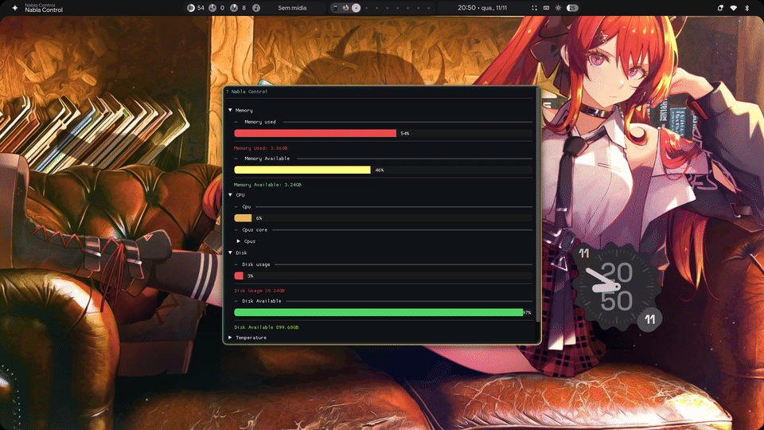
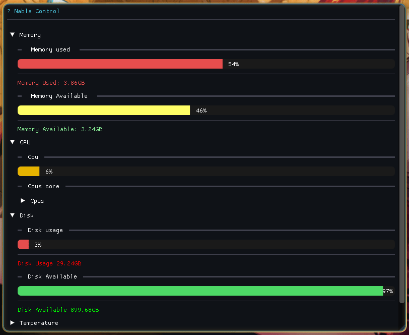
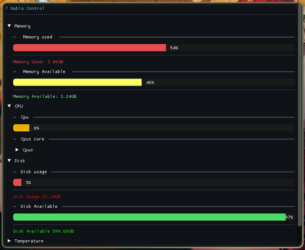
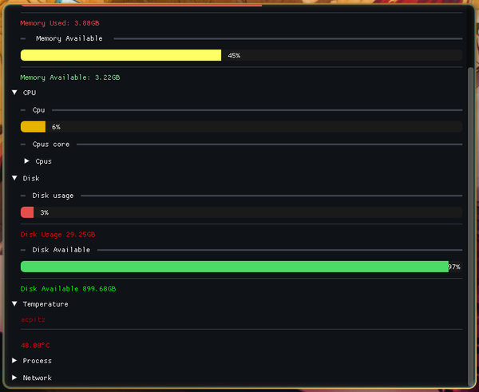
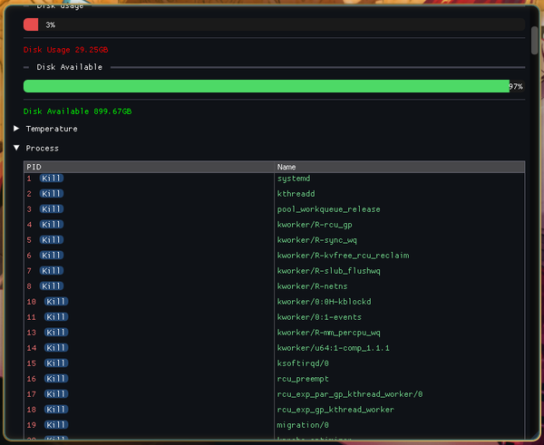
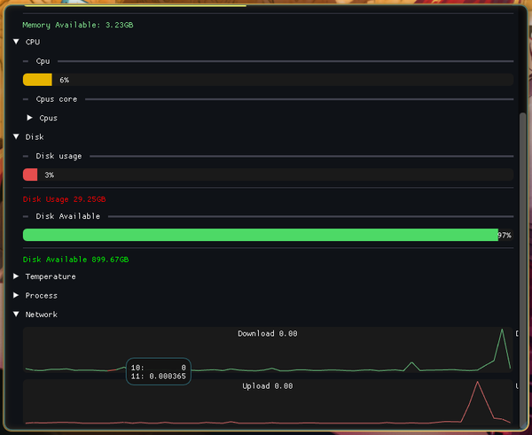
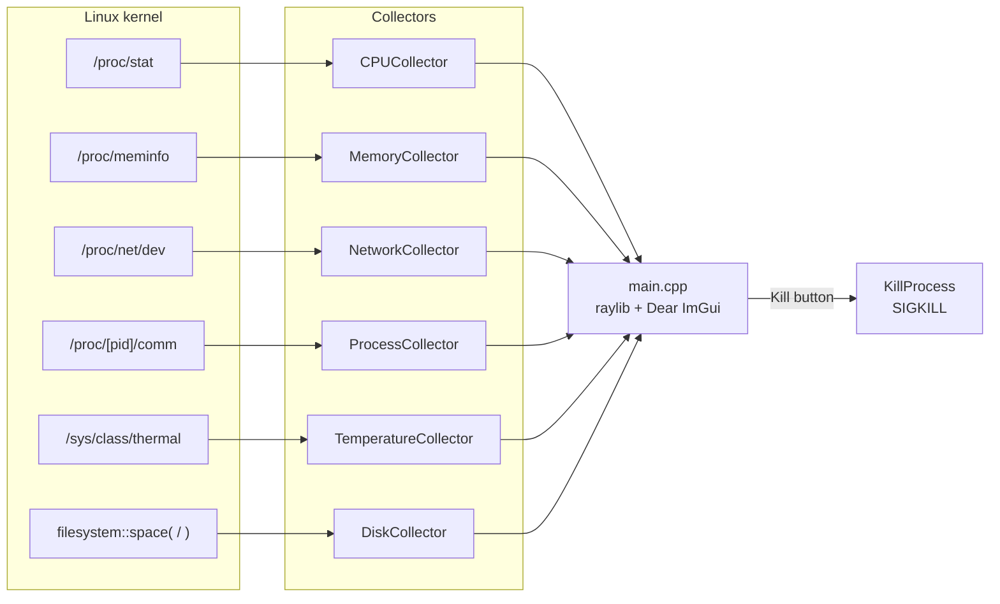

<div align="center">

# ∇ Nabla Control

**A lightweight, real-time system monitor for Linux, written in modern C++.**

Nabla Control reads straight from the kernel (`/proc` and `/sys`) and renders a clean,
GPU-accelerated dashboard with [Dear ImGui](https://github.com/ocornut/imgui) on top of [raylib](https://github.com/raysan5/raylib).

[](https://en.cppreference.com/w/cpp/20)
[](https://cmake.org/)
[](#requirements)
[](https://github.com/raysan5/raylib)
[](https://github.com/ocornut/imgui)
[](LICENSE)

<br>



</div>

---

## ✨ Features

| | Module | What it shows | Source |
|:-:|---|---|---|
| 🧠 | **Memory** | Used and available RAM, as progress bars and in GB | `/proc/meminfo` |
| ⚙️ | **CPU** | Total CPU usage plus a usage bar for every core | `/proc/stat` |
| 💾 | **Disk** | Used and available space on the root filesystem (`/`) | `std::filesystem::space` |
| 🌡️ | **Temperature** | Thermal sensor name and its reading in °C | `/sys/class/thermal/thermal_zone0` |
| 📋 | **Processes** | Every running process (PID and name), each with a **Kill** button | `/proc/<pid>/comm` |
| 🌐 | **Network** | Live download/upload graphs covering the last 60 seconds (MB/s) | `/proc/net/dev` |

- **No dependencies to install by hand.** raylib, Dear ImGui and rlImGui are fetched and built by CMake.
- **Talks to the kernel directly.** There are no daemons, no background services and no extra libraries for reading system data.
- **Collapsible sections**, so you only see the modules you care about.
- **A dark theme with cyan accents** that looks good on any desktop.

## 🎬 A quick tour

<div align="center">

</div>

<table>
  <tr>
    <td align="center"><b>Memory · CPU · Disk</b><br></td>
    <td align="center"><b>Temperature</b><br></td>
  </tr>
  <tr>
    <td align="center"><b>Process manager</b><br></td>
    <td align="center"><b>Network traffic</b><br></td>
  </tr>
</table>

## 📦 Requirements

- **Linux.** Nabla Control reads `/proc` and `/sys`, so it does not run on Windows or macOS.
- **A C++20 compiler**, such as GCC 11+ or Clang 14+
- **CMake 3.25** or newer
- **Git**, which CMake uses to download the dependencies
- **The development headers raylib needs** for X11 and OpenGL:

<details>
<summary><b>Fedora</b></summary>

```bash
sudo dnf install gcc-c++ cmake git \
    libX11-devel libXrandr-devel libXinerama-devel libXcursor-devel libXi-devel \
    mesa-libGL-devel
```
</details>

<details>
<summary><b>Ubuntu / Debian</b></summary>

```bash
sudo apt install build-essential cmake git \
    libx11-dev libxrandr-dev libxinerama-dev libxcursor-dev libxi-dev \
    libgl1-mesa-dev
```
</details>

<details>
<summary><b>Arch Linux</b></summary>

```bash
sudo pacman -S base-devel cmake git \
    libx11 libxrandr libxinerama libxcursor libxi mesa
```
</details>

## 🚀 Getting started

```bash
# 1. Clone the repository
git clone https://github.com/rafael-hacker/Nabla-Control.git
cd Nabla-Control

# 2. Configure (the first run downloads raylib, Dear ImGui and rlImGui)
cmake -B build -DCMAKE_BUILD_TYPE=Release

# 3. Build
cmake --build build -j$(nproc)

# 4. Run
./build/nabla-control
```

### Installing system-wide (optional)

```bash
sudo cmake --install build
nabla-control
```

By default the binary goes to `/usr/local/bin`. Pass `--prefix <dir>` to `cmake --install` to put it somewhere else.

## 🕹️ Usage

- Click a section header (**Memory**, **CPU**, **Disk**, **Temperature**, **Process**, **Network**) to expand or collapse it.
- Expand **CPU → Cpus** to see the usage of each core.
- Hover over the network graphs to read exact values.
- In the **Process** table, click **Kill** next to a PID to end that process.

> [!WARNING]
> **Kill** sends `SIGKILL` right away and does not ask for confirmation. The process cannot catch or ignore the signal, so any unsaved work in it is lost.
> You can only kill processes that you own, unless you run Nabla Control with elevated privileges.

## 🏗️ How it works

Each frame, the main loop asks a set of small, independent **collectors** for fresh data and draws it with Dear ImGui.
CPU and network values need two samples to compute a rate, so they are refreshed once per second.



### Project structure

```
Nabla-Control/
├── CMakeLists.txt           # Build config; fetches raylib, Dear ImGui and rlImGui
├── collectors/              # One file per data source
│   ├── CPUCollector.cpp
│   ├── DiskCollector.cpp
│   ├── MemoryCollector.cpp
│   ├── NetworkCollector.cpp
│   ├── ProcessCollector.cpp
│   └── TemperatureCollector.cpp
├── include/                 # Public headers for the collectors
├── src/
│   ├── core/
│   │   ├── KillProcess.cpp  # Sends SIGKILL to a PID
│   │   └── SystemSnapshot.hpp
│   └── main.cpp             # Window, theme and UI layout
└── assets/                  # README media
```

## 🧩 Built with

- [**raylib**](https://github.com/raysan5/raylib): windowing, input and OpenGL rendering
- [**Dear ImGui**](https://github.com/ocornut/imgui): immediate-mode UI
- [**rlImGui**](https://github.com/raylib-extras/rlImGui): the bridge between raylib and Dear ImGui

## ⚠️ Known limitations

- Only the **first thermal zone** (`thermal_zone0`) is read. If your system doesn't have one (some VMs and containers don't), the app exits on startup.
- Disk usage covers only the **root filesystem** (`/`).
- Network throughput is the **sum of all interfaces** except loopback.

## 🤝 Contributing

Contributions, bug reports and feature ideas are welcome.

1. Fork the repository.
2. Create a branch: `git checkout -b feat/my-feature`
3. Commit your changes: `git commit -m "feat: add my feature"`
4. Push the branch and open a pull request.

## 📄 License

Nabla Control is released under the [MIT License](LICENSE).

<div align="center">
<br>
Made with ☕ and C++ by <a href="https://github.com/rafael-hacker">rafael-hacker</a>
</div>
